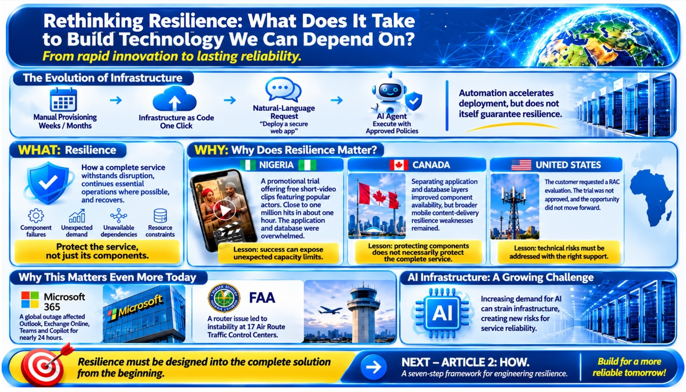

# Rethinking Resilience: What Does It Really Take to Build Technology We Can Depend On?
### *From rapid innovation to lasting reliability.*

By **Mahamat Hissein GUIAGOUSSOU** | Developer Community Leader & Senior Cloud and AI Architect | [LinkedIn Profile](https://www.linkedin.com/in/mahamathisseinguiagoussou/)

---

## From Manual Provisioning to Intelligent Automation

I remember when provisioning infrastructure for a new project could take several weeks or even a few months. Today, with Infrastructure as Code (IaC), we can provision complex environments through a largely automated process, sometimes with a single click.

Technology continues to evolve. We have moved from centralized computing and traditional infrastructure to distributed systems, cloud computing, and artificial intelligence. Natural-language interfaces and AI agents are beginning to change how we request, provision, and manage technology.

Our ability to build, deploy, and scale systems has changed dramatically.

But has our ability to build systems we can truly depend on evolved at the same pace?

## WHAT: What Does Resilience Really Mean?

We often associate resilience with redundancy, high availability, backups, or disaster recovery. These are important capabilities, but none of them alone guarantees that a service will remain available when something goes wrong.

Resilience is about how a complete system behaves when faced with unexpected conditions: component failures, sudden demand, unavailable dependencies, resource constraints, or events that were not anticipated during design.

A system may have redundant infrastructure and still experience a service disruption. Data may be protected while the application cannot access it. Individual components may remain operational while the complete service is unavailable.

Resilience is not simply about protecting components. It is about protecting the service.

## WHY: Why Does Resilience Matter?

The consequences of failure are not limited to a server going offline or an application returning an error. A disruption can affect customers, business operations, public services, safety, and the people responsible for delivering and supporting those services.

The following experiences, from three telecommunications environments, showed me different ways a service can become vulnerable even when a solution appears technically sound.

### When Success Becomes the Failure Scenario

Early in my career, I worked as a Senior Solution Engineer supporting one of Nigeria’s leading mobile telecommunications operators, serving more than 10 million subscribers.

I proposed a promotional initiative built around temporary, free short-video clips featuring popular actors. At the time, mobile phones had evolved into advanced Java-capable feature phones, predecessors to today’s Android smartphones. Downloadable content consisted mostly of images, ringtones, and Java applications, while short-form video was still relatively new.

During a trial intended to demonstrate the solution’s functionality, the promotion generated close to one million hits in approximately one hour. The trial was not designed to validate production-scale performance or reliability under that level of demand. The application and database were running on the same machine, which became overwhelmed and crashed.

The response was far greater than expected. A successful idea exposed a capacity limitation in the trial environment.

Sometimes, success itself becomes the failure scenario.

### Protecting Components Is Not Enough

A few years earlier, during my first startup experience, I was working as a customer engineer on a project for one of Canada’s largest wireless service providers.

I remember how our field team spent weeks configuring two Sun servers in a data center for the customer to test. One hosted the database and the other the application. We had even named the servers after our daughters.

As we were preparing to leave for the airport after a successful proof of concept (PoC), I turned the physical key on the front of one of the Sun servers, thinking I was locking and securing it. Instead, I powered the system down.

We scrambled to bring the environment back online. My colleague was understandably worried about missing his flight, and we barely made it to the airport. Fortunately, this was an isolated trial and quality-assurance environment, so no end-user services were affected.

It was a frustrating moment, but it taught me an important lesson: operational failures do not always come from complex technical defects or malicious actions. Sometimes, a simple and innocent human action can have serious consequences if the environment does not provide the right safeguards.

That lesson becomes even more important in critical environments such as aviation, banking, and healthcare, where connected devices may monitor essential functions, including a patient’s vital signs.

Later, while continuing to support the same Canadian wireless provider in a production setting, I was involved in further improving availability beyond the original separation of the application and database layers. That work improved component-level availability. However, an unexpected mobile content fulfillment transaction flow later revealed resilience weaknesses that could not be addressed by looking at those components individually.

The experience reinforced an important distinction: improving the availability of components in isolation does not automatically make the complete service resilient. The application, data, network, infrastructure, and their dependencies must work together.

### Recognizing a Risk Is Only the First Step

In another engagement with a major wireless provider in the United States, the customer had selected a custom architecture built around a free, open-source, non-clustered version of MySQL, deployed mainly in the context of the customer’s Research & Development (R&D) ecosystem while using our product as their application layer. Our field team identified the database as a single point of failure and raised the concern with the customer.

The customer formally asked Oracle to support an evaluation of Oracle Real Application Clusters (RAC) alternative architecture, to assess how the integrated Oracle Mobile Content Delivery Server would perform with a clustered database backend. The objective was to determine whether the proposed architecture could meet the customer’s end-to-end functional and non-functional requirements for a telecommunications enterprise environment.

This was not simply about database availability. The evaluation needed to consider the complete application experience, including over-the-air application download times, latency, jitter, and the performance requirements of the mobile content-delivery service.

Oracle leadership ultimately made a business decision not to approve the requested free trial. As a result, the customer could not evaluate the proposed RAC-backed architecture within the planned budget for that engagement, and the opportunity did not move forward. Although the requested evaluation did not proceed, the experience highlighted a broader challenge: technical risks can be identified, but addressing them requires organizational alignment, investment, and a willingness to validate alternative approaches.

In the months that followed, Oracle did not secure a more strategic and viable customer for our Mobile Content Delivery product. Meanwhile, the market was changing as Apple and Google introduced and expanded their own competing application-download ecosystems. Oracle eventually discontinued the Mobile Content Delivery Server product.

The discontinuation affected the supporting teams on both sides: at Oracle and at the wireless telecommunications provider.

This experience made the consequences particularly tangible. Resilience is not only about protecting technology and business operations. It also depends on the business decisions, investment, and organizational commitment needed to sustain a solution. Those decisions can ultimately affect people’s livelihoods.

Recognizing a technical risk is important. Having the organizational support to address it is equally important.

### The Common Lesson: Protect the Complete Service

These experiences point to a common lesson: protecting individual components does not necessarily protect the service.

An application can be redundant while its database is not. A storage system can protect data while the application cannot reach it. Infrastructure can remain available while a critical dependency prevents the business service from operating.

A seemingly harmless operational action can also interrupt a service when appropriate safeguards are missing.

Resilience must extend across the complete solution: application, database, network, infrastructure, dependencies, people, and operations.

## Why This Matters Even More Today

Cloud computing and artificial intelligence are increasing the scale, interdependence, and complexity of modern systems. AI workloads place growing demands on compute, networking, storage, power, and data availability.

At the same time, organizations increasingly depend on shared platforms and communications infrastructure for essential operations.

Recent incidents and emerging capacity constraints demonstrate that the effects of a failure can extend well beyond the component where the problem begins.

### Microsoft 365: When a Global Platform Becomes Unavailable

Beginning November 12, 2026, a global Microsoft 365 disruption affected Exchange Online and other services, including Outlook, Teams, Copilot, and related capabilities. Affected users experienced disruption for nearly 24 hours. Microsoft’s preliminary post-incident findings described a combination of factors: a software defect in networking gateway infrastructure, increased traffic following a Teams failover, and reduced server capacity. Together, these conditions contributed to cascading failures across the platform. These findings were preliminary at the time of this article’s preparation.

The incident affected organizations and users worldwide, disrupting access to email and other business functions. It demonstrated how a defect or capacity problem in shared infrastructure can propagate across multiple services and affect organizations that depend on them.

### FAA: When Critical Communications Infrastructure Becomes Unstable

The next day, on November 13, 2026, the Federal Aviation Administration issued a nationwide ground stop for departures at U.S. airports following instability in telecommunications systems supporting air traffic control. The FAA’s preliminary investigation examined excessive traffic entering its telecommunications network during work to transition legacy copper connections to fiber. Officials identified a recently deployed router at a remote communications facility as one possible source of the traffic. Investigators had not established a final root cause at the time of this article’s preparation. The FAA reported instability at 17 of its 22 Air Route
